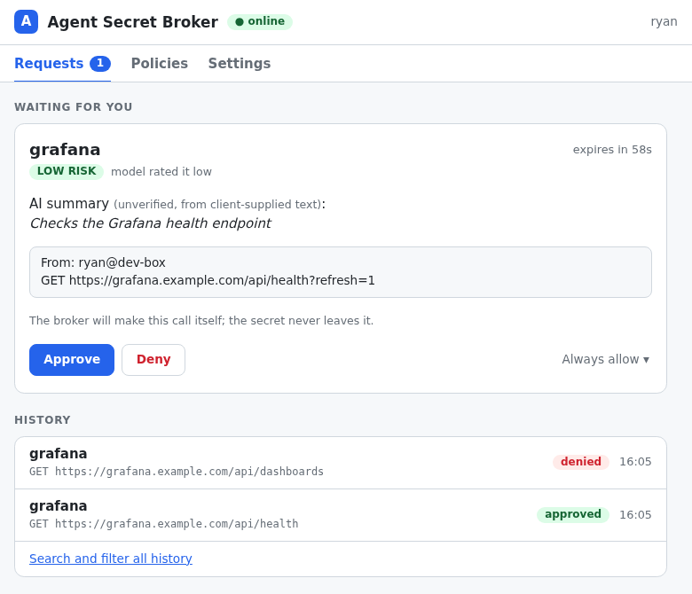

# agent-secret-broker

Give a CLI agent (Claude Code, scripts, anything that shells out) access to
credentials **only after a human approves each use**, with a full audit trail.
Self-hosted, no MCP.

    agent                         broker                          you
      | asb http NAME ...           |                              |
      |---------------------------->|  push: "NAME, GET /x [LOW]"  |
      |                             |----------------------------->|
      |                             |      tap -> SSO login -> Approve
      |                             |<-----------------------------|
      |<-- response (secret masked) |                              |

The agent never holds the vault password or the approval channel. Approval
happens on a web page that only your authenticated SSO session can reach, from a
push notification or the dashboard.

- **The vault is the catalog.** Every login and secure note in the broker's
  Bitwarden/Vaultwarden collection is a credential, with safe defaults you can
  tune. No config file lists your secrets.
- **Pluggable storage, vault optional.** The broker talks to its store through a
  small, documented backend contract (Bitwarden/Vaultwarden, or a built-in
  AES-256-GCM encrypted file with an admin CLI and a one-time Bitwarden import),
  with a conformance test suite for writing your own:
  [docs/reference.md](docs/reference.md#backend-contract).
- **The agent never sees the value** in `http` mode: the broker makes the call and
  substitutes `{{VAR}}` placeholders itself.
- **Every use is approved or explicitly allow-listed**, rated by a risk model, and
  written to a hash-chained audit log.

## Quick start

1. **Run the broker** (Docker, a vault account, an SSO proxy): [docs/setup.md](docs/setup.md).
2. **Install the CLI** on the agent's machine and point it at the broker:
   [docs/cli.md](docs/cli.md).
3. **Tell the agent about it** with a short paragraph in its instructions
   (copy-paste text in [docs/cli.md](docs/cli.md#teaching-an-agent-to-use-it)). The CLI
   documents itself: `asb guide`.

Then:

    asb which api.example.com
    asb http example GET https://api.example.com/v1/things \
        -H 'Authorization: Bearer {{EXAMPLE_TOKEN}}'
    # your phone or browser asks; you approve; the response comes back

## The web app

`https://<your approval site>/` has three tabs: **Requests** (what is waiting, and
recent history), **Policies** (standing approvals, with Revoke), and
**Settings** (browser and push notifications). It follows your system light or
dark setting and works on a phone.

## Documentation

| | |
|---|---|
| [docs/setup.md](docs/setup.md) | Install and configure the broker, step by step |
| [docs/deploy.md](docs/deploy.md) | Deploy through Komodo's API and verify with `asb status`, no host shell needed |
| [docs/cli.md](docs/cli.md) | Install `asb`, use it, and set up agents; exit codes; troubleshooting |
| [docs/guidance.md](docs/guidance.md) | Per-credential risk guidance: how it works and starter texts for common services |
| [docs/rehearsal.md](docs/rehearsal.md) | `tools/rehearse_local_backend.py`: an end-to-end rehearsal of the encrypted local backend (real broker, real CLI, Docker) before you rely on it |
| [docs/reference.md](docs/reference.md) | How it works: catalog format, policy and risk, notifications, storing credentials, audit, threat model |

## Threat model, in one paragraph

This protects against an agent (or a prompt injection steering it) using
credentials without you noticing. It does **not** protect against an agent that
already holds other credentials to your SSO provider, vault, notification service
or the broker's host: those bypass the gate, so move them behind the broker or
remove them. Details in [docs/reference.md](docs/reference.md#threat-model-honestly).

## Development

    pip install -r requirements.txt
    python3 -m unittest discover -s tests

Python 3.12. Runtime dependency: `pywebpush` (pinned in `requirements.txt`). The
CLI (`client/asb`) has no dependencies.

## License

MIT
